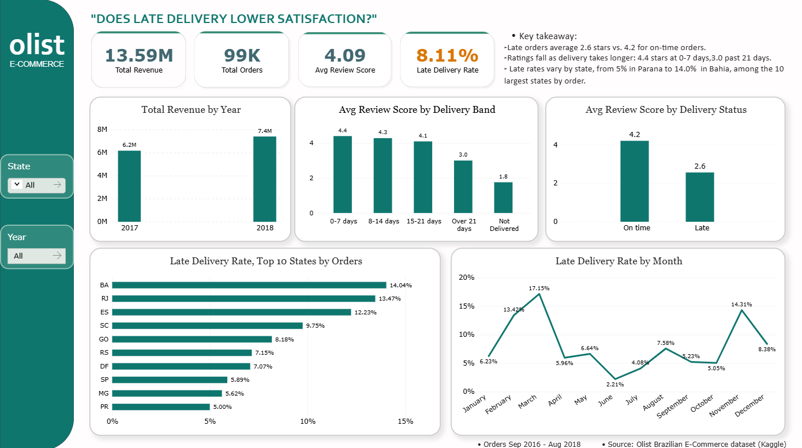

# Olist E-commerce Customer Experience Dashboard
### Power BI Dashboard analysing how late deliveries affect customer ratings for 99k Olist e-commerce orders.

**Question:** Does late delivery lower customer satisfaction?

**Answer:** Yes. Late orders average 2.6 stars, against 4.2 for on-time orders. Ratings fall as delivery takes longer, from 4.4 stars at 0–7 days to 3.0 past 21 days.

## Key findings
- Late orders average 2.6 stars vs. 4.2 for on-time orders.
- Ratings fall as delivery takes longer: 4.4 at 0–7 days, 3.0 past 21 days.
- Among the 10 largest states by orders, late rates range from 5.0% (Paraná) to 14.0% (Bahia).

## Data
Olist Brazilian E-commerce dataset (Kaggle), orders from Sep 2016 to Aug 2018.

## Tools
Power BI, Power Query, DAX

## Files
- `Olist_Customer_experience_Dashboard.pbix`: the Power BI report (open in Power BI Desktop)
- `Dashboard.png`: screenshot of the dashboard

## Demo video
[Watch the demo](https://youtu.be/PSfl7atgc0U?si=a8souWUDu3W2G0mk)
